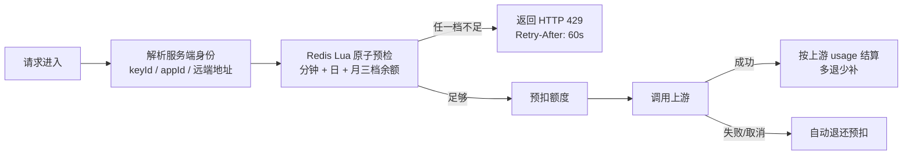

# PRD · 多模型统一 AI 网关

> 版本 v1.0 ｜ 维护：ShigureYukina
> 定位说明：本文档是本仓库的**产品需求文档**，回答"为谁做、做什么、边界在哪"；
> 功能清单以仓库真实实现为准（74 个端点见 `docs/api-inventory.md`，能力级规格见 `openspec/specs/`），
> 性能数字与 `docs/load/README.md` 同口径。

---

## 一、背景与问题

一个业务应用要接入大模型，面对的不是"一个 API"，而是一组各不相同的麻烦：

| # | 问题 | 具体表现 |
| --- | --- | --- |
| 1 | **协议差异** | OpenAI Chat Completions、Anthropic Messages、OpenAI Responses 三套请求/响应/流式事件格式各不相同，切换供应商=重写适配层 |
| 2 | **稳定性差异** | 各供应商 429/5xx 频率、限流策略、故障恢复时间不同，单点接入没有容灾 |
| 3 | **计费差异** | 各家计价单位与价格不同，用量与成本没有统一账本，多接入方无法分账 |
| 4 | **密钥分散** | 各应用自带供应商密钥，泄露面大、无法统一轮换，客户端密钥还会被透传到不可控链路 |
| 5 | **共享缺位** | 企业内多个团队/应用各自接入，无法安全地共享同一份供应商资源，也没有租户级的配额与隔离 |

**结论**：需要一个统一网关，把"接入"收敛为一次对接，把路由容灾、配额管控、密钥治理收拢到平台层。

## 二、产品定位与目标用户

**定位**（与 README 一致）：面向 LLM 接入场景的统一 AI 网关——对外提供 OpenAI 兼容接口，
对内支持多 Provider 路由、流式透传、配额治理与韧性保护；并向多租户平台演进，
支撑**企业内部多个团队或应用安全、可控地共享同一网关**（见 `openspec/changes/archive/2026-09-10-add-multi-tenant-platform/proposal.md`）。

| 用户 | 诉求 | 使用面 |
| --- | --- | --- |
| 接入方开发者 | 用 OpenAI SDK 直接连上所有模型，流式不卡、报错看得懂 | 数据面 API（`/v1/*`） |
| 平台管理员 | 管 Key、管路由、管限流，出问题能定位到跳 | 控制台 + 管理面 API |
| 租户管理员 | 团队自带 Key（BYOK）、管自己的模型白名单与配额、看自己的账单 | 多租户管理 API + 账单导出 |

## 三、产品目标与成功指标

| 目标 | 指标 |
| --- | --- |
| 接入零改造 | 接入方使用任意 OpenAI 官方 SDK 可直连；模型切换不改代码 |
| 故障无感 | 单一上游/单把 Key 故障自动切换，调用方不感知 |
| 成本可控 | 分钟/日/月三档配额原子校验，无超发；用量与成本可按租户/应用/模型出账 |
| 排障高效 | 每个请求有 requestId 与全跳链路（路由→缓存→配额→上游→首字→收尾），P95 与成功率可按模型观测 |

## 四、功能边界（Non-goals）

明确不做的事，与要做的事同样重要：

- **不做**模型训练/微调、RAG 与向量检索、Prompt 管理平台——网关只管"调用的治理"，不管"模型能力"；
- **不做**面向 C 端用户的聊天产品——控制台是管理工具，不是对话产品；
- **不做**面向外部的 API 转售/分发（令牌商城、充值兑换）——定位是企业内部共享网关，不是商用分发平台（与同类产品 New API 的定位差异，见竞品分析）；
- **不透传**客户端凭证——客户端 Authorization 只用于平台鉴权，上游只认平台配置化凭证，客户端密钥不出现在上游链路；
- **不做**语义缓存的跨租户共享——缓存按租户隔离，避免污染与信息泄露。

## 五、用户故事

1. 作为**接入方开发者**，我用 OpenAI SDK 把 base URL 指到网关就能用上 Claude——流式事件、报错格式与官方行为一致。
2. 作为**平台管理员**，我把同一渠道的多把 Key 配成池子，某把 Key 被限流后流量自动切到次优 Key，只隔离"一把钥匙"而不是整个渠道。
3. 作为**平台管理员**，我给某供应商配置多个上游互为降级通道，主通道故障时请求自动走备通道。
4. 作为**租户管理员**，我给团队设置"每分钟 1 万 / 每天 10 万 / 每月 300 万 token"的三档配额，超发不可能发生。
5. 作为**租户管理员**，我导出本月的 CSV 账单，看到每个模型的调用次数与成本估算。
6. 作为**平台管理员**，出问题时我打开"实时链路"页，按 requestId 看到这个请求卡在哪一跳。

## 六、功能需求分级

优先级：P0=没有则产品不成立；P1=治理闭环必需；P2=平台化增强。

| 编号 | 能力 | 内容 | 锚点 |
| --- | --- | --- | --- |
| F1 (P0) | OpenAI 兼容入口 | `POST /v1/chat/completions` 流式（SSE）与非流式；`GET /v1/models` 按调用凭证返回真实可用模型 | 数据面 5 端点 |
| F2 (P0) | 多 Provider 路由 | 静态路由、模型别名映射、Fallback 优先级链；字段（tools/response_format/top_p 等）原样透传，避免"到网关就丢" | `ProviderRoutingService` |
| F3 (P0) | 配额治理 | 分钟/日/月三档 token 配额，Redis ledger 预扣-结算-退还（见 7.1） | `RedisTokenQuotaService` |
| F4 (P0) | 错误契约 | 错误体统一为 OpenAI `error.type/error.code` 形状，官方 SDK 可直接分类重试；流内错误转错误帧并补 `[DONE]`，不硬断流 | 错误处理约定 |
| F5 (P0) | 上游凭证管理 | 平台级凭证配置化（DB/yml 双轨），客户端凭证不透传上游 | `provider-credentials` |
| F6 (P1) | 原生协议入口 | `POST /v1/messages`（Anthropic Messages 原生事件流 + count_tokens）、`POST /v1/responses`（Responses 原生事件）；错误体按各自协议返回，内部复用同一治理链路 | 协议适配层 |
| F7 (P1) | 通道组与负载均衡 | 多 provider 组组绑定模型，五种策略：优先级降级/轮询/随机/加权/动态健康分（成功率 40%+延迟 30%+成本 30%，结果回灌） | `provider_group` 三表 |
| F8 (P1) | 渠道 Key 池与限速 | 多 Key 加权轮换；连败达阈值冷却 60s 切次优 Key；渠道级 RPM（Redis 分钟定窗，超限按"通道暂不可用"触发回退）；未配置零开销 | Key 池模块 |
| F9 (P1) | 韧性治理 | 超时、重试（429/5xx）、Fallback、Resilience4j 熔断（按 provider 实例） | 韧性配置 |
| F10 (P1) | 缓存 | 精确 Hash 命中 + Trigram Jaccard 相似度匹配（阈值可配，默认 0.85），命中统计与趋势 | 缓存模块 |
| F11 (P1) | 安全策略 | 输入/输出策略（拦截/放行）、Prompt Injection 检测、PII 脱敏、文本沙箱检测；SSRF 出站校验（定位与残余风险见 7.4） | 安全模块 |
| F12 (P1) | 可观测 | Prometheus 指标（模型级调用量/成功率/P95/成本）、Micrometer Tracing + OTel、X-Request-Id、限流响应头 | `AiGatewayMetricsRecorder` |
| F13 (P1) | 控制台 | 11 页管理界面（见第八节），JWT 鉴权，admin/viewer 双角色，bcrypt，prod 拒绝明文口令 | `gateway-console` |
| F14 (P2) | 多租户平台 | API Key 鉴权解析租户/应用身份、租户模型白名单、租户级配额、BYOK（租户 Key 优先于平台凭证）、租户隔离缓存、usage 明细与 CSV 账单、租户维度指标 | 6 个 capability spec |
| F15 (P2) | 渠道主动探测 | 定时探测（默认 5 分钟一轮），连败 3 次禁用、冷却恢复；429 与"没配 Key"不计失败；三种不可用状态并列（staticDisabled/manualDisabled/down），多实例三层去重 | 探测模块 |
| F16 (P2) | 实时请求链路 | SSE 推送每跳（route→cache→quota→upstream→first-token→收尾），控制台时间线；无人订阅零开销 | `/v1/trace/stream` |
| F17 (P2) | 元数据自动同步 | models.dev 拉价格 + 各渠道 `/v1/models` 发现模型；价格分层：人工覆盖 > yml > 自动同步，自动值永远盖不住手写值 | 同步模块 |
| F18 (P2) | 插件链 | 请求前/响应后插件机制，运行时启停（request-id-inject、response-trace 内置） | 插件模块 |
| F19 (P2) | A/B 灰度 | 分桶仿真与命中预览，控制台可配 | 灰度模块 |

## 七、关键规则设计

### 7.1 配额规则（三档配额，原子防超发）

- **三档时间窗**：分钟 / 日 / 月（`token-quota-per-minute / -day / -month`），任一档耗尽即 429；
- **原子校验防超发**：预检与扣减在同一段 Lua 脚本内完成，并发请求不可能同时通过校验；
- **预扣-结算-退还**：请求前按 max_tokens 预扣，成功后按上游回传 usage 实结，失败与客户端取消自动退还；
- **配额键只认服务端身份**：userId→认证 keyId、consumer→认证 appId、ip→连接远端地址——客户端请求头可任意伪造，不参与配额键（自定义可信维度需显式配置）；
- **可感知**：响应带 `x-ratelimit-limit/remaining-tokens`（含 `-day` 变体），超限带 `Retry-After`。

### 7.2 错误契约

- 错误体统一为 OpenAI `{"error":{"message","type","code","param"}}` 形状，接入方用官方 SDK 即可分类与重试；
- 流式请求内出错：转错误帧并补 `[DONE]`，客户端得到合法流而不是被硬断；
- 原生协议入口（Messages/Responses）按各自协议的错误体返回，但内部复用同一条治理链路与错误分类。

### 7.3 路由容灾

- **三个互相独立的可用性来源并列维护**：配置禁用（staticDisabled）、控制台人工禁用（manualDisabled）、探测结论（down）——不合并成一个状态，控制台分别展示并给出中文原因；
- **故障隔离到 Key 粒度**：一把 Key 连败冷却 60s，流量切次优 Key；整渠道故障才走通道组降级；
- **探测不计假失败**：429 说明渠道是活的、"没配 Key"是配置问题，均不计入失败计数——否则会把完好的渠道关掉，还要多等一个冷却周期；
- **健康分路由**：成功率 40% + 延迟 30% + 成本 30%，每次调用结果回灌，动态排序候选。

### 7.4 安全边界（诚实披露）

- 上游出站地址全部过 SSRF 校验（拒绝非 http(s)、userinfo 混淆、云元数据主机名、私网/回环/保留网段；私网放行由配置显式控制）；
- **已知残余风险（未修）**：校验发生在解析时，Netty 连接时重新解析 DNS，两次解析之间存在 DNS TOCTOU/rebinding 窗口——本层的定位是"把误配置与顺手可得的 SSRF 挡在写入口"，不是"对抗能控制 DNS 的攻击者"；减轻手段是管理面写权限与审计；
- 上游密钥经主密钥（`MASTER_KEY`）加密存储，缺失拒绝启动；prod 拒绝明文控制台口令。

## 八、控制台信息架构

| 页面 | 功能 |
| --- | --- |
| 网关调试 | 发送流式/非流式请求的调试台 |
| 模型发现 | 按 baseUrl + Key 探测上游模型清单 |
| 模型观测 | 模型级调用量/成功率/P95/成本 |
| 实时链路 | SSE 订阅，按 requestId 画全跳时间线 |
| 限流配额 | 限流配置读写 + 当前用量 |
| 路由策略 | 路由/Fallback 配置、路由预览、A/B 分桶仿真 |
| 缓存与灰度 | 缓存配置/统计/趋势 + 灰度配置 |
| 插件管理 | 插件启停与配置 |
| 安全策略 | 输入输出策略 + 文本沙箱检测 |
| 操作审计 | 本地/服务端审计日志、导出 JSON |
| 账单导出 | 按日期导出 CSV |

**已知产品缺口（backlog）**：租户配置、上游凭证（BYOK）、通道组、渠道健康目前只有管理 API、没有控制台页面——运营这些配置需要走 API，平台化管理尚未闭环，是控制台迭代的第一优先项。

## 九、非功能需求

| 维度 | 要求 | 实测/依据 |
| --- | --- | --- |
| 性能 | 网关转发开销控制在毫秒级 | 本机受控环境基线：稳态 P50 37.7ms / P95 44.6ms / 503 RPS，网关开销 ≈1.7ms（对照直连上游）。**结论只适用于本机受控环境，不代表生产容量**；历史 commit 中的旧吞吐口径（11.5k RPS）不引用 |
| 流式体验 | 首字节后不回退：吐过事件后禁止跨供应商重试，避免客户端收到两段拼接 SSE | 首字节硬边界（chunkServed），用法混算被禁止 |
| 可靠性 | 失败路径有延迟预算，重试只针对 429/5xx | `docs/load/README.md` 含失败路径延迟测量 |
| 安全 | 见 7.4；无真实流量密钥不入库 | `.env.example` 模板化 |
| 可测试 | 主流程可无真实上游端到端验证 | `scripts/simulate_e2e.ps1`（mock provider） |
| 兼容性 | 字段透传：未显式建模的请求字段原样到达上游 | tools/response_format/top_p 等 |

## 十、里程碑

**已交付**（P0–P2 全量，见 `docs/api-inventory.md` 与 README 项目亮点表）：OpenAI 兼容 + 原生协议双入口、
多 Provider 路由与通道组五策略、Key 池与渠道限速、三档配额与账单、缓存、安全策略、多租户平台、
控制台 11 页、可观测全链、Nacos 配置中心。

**规划中**（对齐 README Roadmap 未完成项）：

| 里程碑 | 内容 |
| --- | --- |
| M1 控制台平台化闭环 | 补租户配置/BYOK/通道组/渠道健康四组页面，消灭"只有 API 没有页面"的缺口 |
| M2 可视化运维 | Prometheus + Grafana 面板模板化 |
| M3 真实上游 smoke test | 受控 Key/限额下的真实供应商冒烟验证 |
| M4 竞品对比维护 | 见《竞品分析-AI网关.md》（本文档姊妹篇），随竞品迭代更新 |

## 十一、风险与开放问题

| # | 问题 | 状态 |
| --- | --- | --- |
| 1 | DNS rebinding 残余风险（7.4） | 已知未修，定位与减轻手段已披露；彻底修复需连接期 DNS 过滤 |
| 2 | 流式请求配额错误契约：SSE preCheck 阶段的错误目前走默认处理 | 已知，规划统一到错误契约 |
| 3 | 语义缓存相似度阈值（0.85）对不同语种的误命中/漏命中 | 开放：需按接入方语料分布调参 |
| 4 | 计费为成本估算（按模型价格），非财务口径账单 | 定位如此，导出 CSV 供财务二次加工 |

## 关联文档

- 竞品参照：《竞品分析-AI网关.md》（vs New API / Octopus / LiteLLM）
- API 全集：`docs/api-inventory.md` ｜ 多租户规格：`openspec/specs/`
- 性能基线：`docs/load/README.md` ｜ 配置中心：`docs/config/README.md`
